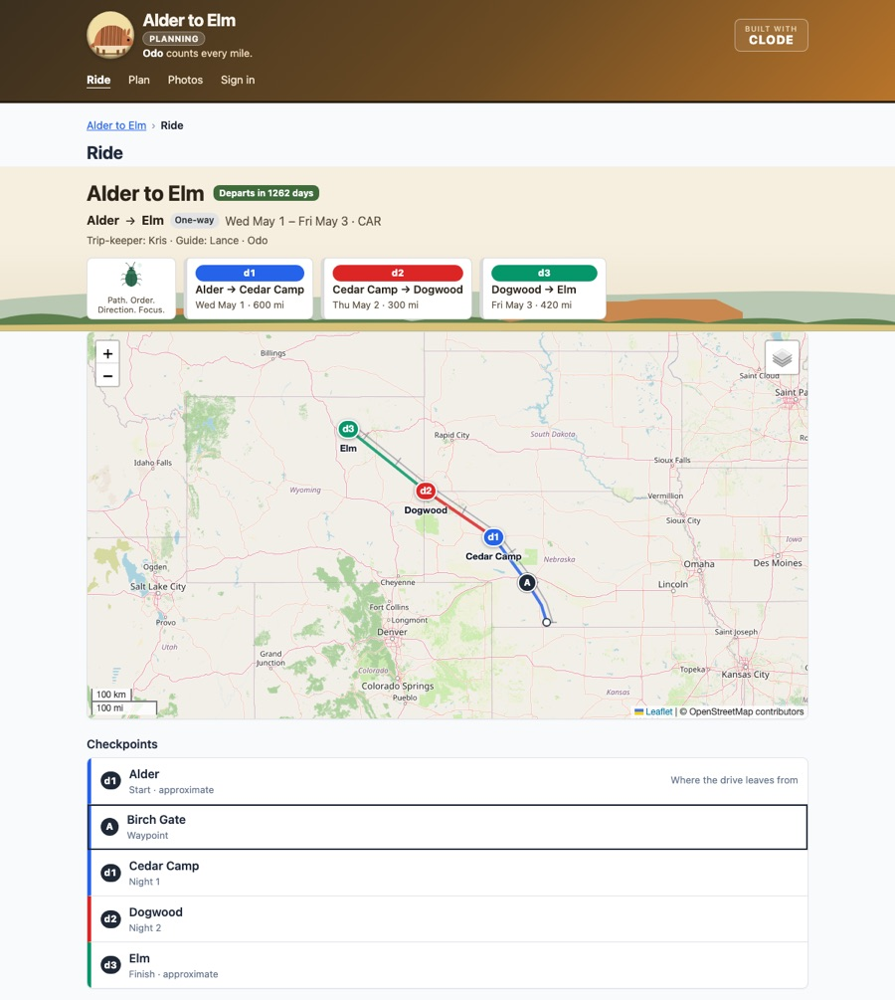
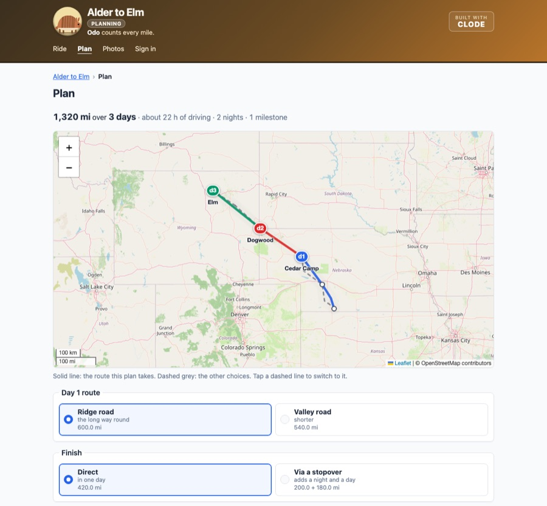

# RoadTrip

A live web page for one road trip. You plan the days, then post from your
phone as the miles go by: check-ins, photos and notes land on a map your
friends and family can follow. It is one small Go program with a SQLite file
beside it, so it runs on the cheapest virtual machine you can rent and there
is nothing to patch from the car.



*The sample trip that ships in `testdata/`: invented places, not a real drive.*

## What you get

- **A ride page for visitors.** The map, each day's leg, the stops with
  arrival times, and the posts and photos from the road.
- **One-tap posting from the phone.** Take a photo and post it; near a
  planned stop it checks you in. Each time is shown in the time zone it
  happened in, so a trip across zones reads correctly.
- **A planner.** Days, miles and driving hours, long days flagged, and
  optional forks ("ridge road or valley road?") that visitors can compare
  and you can settle on the road.
- **Privacy by default.** Your home and your hosts' homes are published as a
  roughly one-kilometre square, never the point. Photos have their GPS and
  camera details stripped before they are stored. Street addresses live in a
  private file only signed-in users see.
- **A driver screen.** Large type for a dash mount: the next stop, an honest
  ETA, a link into your navigation app, and weather alerts for the road
  ahead (United States and Canada).
- **Optional extras**, each off until you give it a key: a trip helper that
  answers "where is fuel, food, a bed?" through the Claude API, traffic and
  destination search through TomTom, and the music that played on the drive.
  See [Optional features](#optional-features).

When the trip ends, the site stays up as a record of it and costs almost
nothing to keep.



## Quick start

You need Docker. This builds the image, starts it on your machine, and loads
the sample trip. Every command runs as written.

```bash
git clone https://github.com/clodemode/RoadTrip.git
```

```bash
cd RoadTrip
```

```bash
docker build -t roadtrip .
```

```bash
docker run -d --name roadtrip -p 8080:8080 -v roadtrip-data:/data -e COOKIE_SECURE=0 -e PUSH_TOKEN=local-dev-token -e ADMIN_PASSWORD_HASH="$(docker run --rm roadtrip -hash 'change-me-please')" roadtrip
```

```bash
curl -s -H 'Authorization: Bearer local-dev-token' -H 'Content-Type: application/geo+json' --data-binary @testdata/trip-fixture.geojson 'http://localhost:8080/driver/trip?activate=1'
```

Open <http://localhost:8080>. To post, sign in at
<http://localhost:8080/driver/login> with username `kris` and the password
`change-me-please`. The first user is always named `kris` (see
[Known limits](#known-limits-for-self-hosters)); once signed in you can add
a user under your own name at `/driver/users`.

What those settings did:

- `ADMIN_PASSWORD_HASH` created the first user. Without any user the site is
  read-only.
- `PUSH_TOKEN` is a password for scripts: it let `curl` push the trip
  without signing in. Use a long random one anywhere but your own machine.
- `COOKIE_SECURE=0` lets the sign-in cookie work over plain `http://`. Leave
  it out wherever the site is served over HTTPS.
- `-v roadtrip-data:/data` keeps the database and photos in a Docker volume,
  so they survive the container.

Stop and remove it with `docker rm -f roadtrip`. Add
`docker volume rm roadtrip-data` to delete the data too.

**Without Docker**, with Go 1.25 or newer:

```bash
mkdir -p data
```

```bash
DATA_DIR=./data COOKIE_SECURE=0 PUSH_TOKEN=local-dev-token ADMIN_PASSWORD_HASH="$(go run . -hash 'change-me-please')" go run .
```

Before you load a trip, a fresh instance shows the plan of the maintainers'
first ride (Austin to San Jose), which is built into the program. See
[Known limits](#known-limits-for-self-hosters).

## Your own trip

A trip is one GeoJSON file. Start from a copy of
[`testdata/trip-fixture.geojson`](testdata/trip-fixture.geojson):

- A `ride` block: a `slug` (lower-case letters, digits and dashes; it names
  the trip), a `name` and a `start_date`.
- One `LineString` per day's drive, numbered with `leg` and `day`.
  Coordinates are `[longitude, latitude]`.
- One `Point` with `"kind": "checkpoint"` per stop, each with an `order`, a
  `name`, a `label` (Start, Night 1, Finish) and its own time zone in `tz`
  (an IANA name such as `America/Denver`). Mark your home, or anyone's home,
  with `"precision": "fuzzed"`.
- Optionally, `Point`s with `"kind": "candidate"` for sights worth a stop,
  and `options` for forks in the route.

Push it, and make it the trip the site shows:

```bash
curl -s -H "Authorization: Bearer $PUSH_TOKEN" -H 'Content-Type: application/geo+json' --data-binary @my-trip.geojson 'https://your-site.example/driver/trip?activate=1'
```

The file is checked completely before anything is stored, and the answer
says what was wrong if it is refused. You can push it again as the plan
changes: stops you have already reached, posts and photos are never
touched. `POST /driver/ride/active` (form field `slug=`) switches between
trips you have pushed. Keep the file out of any public fork: it says where
you live and when you are away.

Full detail, including route options and converting a planning tool's
export: [docs/TRIPS.md](docs/TRIPS.md).

## Deploy your own

RoadTrip needs three things from a host: it runs one container (or one
binary), it keeps one directory (`/data`) across restarts, and it serves
HTTPS. Phones only share their location with HTTPS pages, so do not skip
the last one.

### Fly.io

The repository's `fly.toml` is the maintainers' own. Edit three lines
before you use it:

- `app`: a name of your own. It must be unique across Fly.
- `primary_region`: a [region](https://fly.io/docs/reference/regions/) near
  the trip.
- `SITE_URL`: **delete this line** (or set it to your own address). Left as
  it is, your site redirects every visitor to the maintainers' site.

Then, with [`flyctl`](https://fly.io/docs/flyctl/install/) installed and
signed in, and `<your-app>` and `<region>` replaced by the values you chose:

```bash
fly apps create <your-app>
```

```bash
fly volumes create roadtrip_data --app <your-app> --region <region> --size 1
```

```bash
docker run --rm roadtrip -hash '<your-password>'
```

```bash
fly secrets set --app <your-app> ADMIN_PASSWORD_HASH='<the hash it printed>' SESSION_KEY="$(openssl rand -hex 32)" PUSH_TOKEN="$(openssl rand -hex 24)"
```

```bash
fly deploy
```

Keep the single quotes around the hash: it contains `$` characters. Print
the push token before you set it if you want to use it later
(`openssl rand -hex 24`, then paste the value), because Fly will not show a
secret again.

Your site is at `https://<your-app>.fly.dev`. The machine goes to sleep
when nobody is looking and wakes in well under a second, so an idle site
costs very little.

**Your own domain.** Run `fly certs add trip.example.com --app <your-app>`,
create the DNS record it asks for, then set
`SITE_URL = "https://trip.example.com"` in `fly.toml` and run `fly deploy`
again. Every other address then redirects to that one.

**Backups.** Everything is on the volume. Fly keeps daily snapshots of a
volume for a few days (`fly volumes snapshots list <volume-id>`); for a
copy of your own, fetch `/data/roadtrip.sqlite3`, `/data/users.json`,
`/data/trips/` and `/data/media/` with `fly ssh sftp`.

### Any other machine

Anything that runs a container works. On the server:

```bash
docker run -d --name roadtrip --restart unless-stopped -p 127.0.0.1:8080:8080 -v /srv/roadtrip:/data --env-file /srv/roadtrip.env roadtrip
```

with `/srv/roadtrip.env` holding at least `ADMIN_PASSWORD_HASH`,
`SESSION_KEY` and `PUSH_TOKEN` (copy [`.env.example`](.env.example) and fill
it in; remove its `COOKIE_SECURE=0` line). Put a reverse proxy that handles
HTTPS in front. With [Caddy](https://caddyserver.com) the whole
configuration is:

```
trip.example.com {
    reverse_proxy 127.0.0.1:8080
}
```

With another proxy, allow request bodies of at least 30 MB (a photo can be
25 MB) and do not cut uploads off early: a photo from a weak mobile
connection can take minutes.

There is no separate binary download. To run without Docker, build it with
`CGO_ENABLED=0 go build -o roadtrip .` and run it with `DATA_DIR` pointing
at a directory it can write.

**Backups.** Copy the data directory (`/srv/roadtrip` above). It holds the
database, the photos, the users and your trip files, and nothing else is
needed to restore an instance. Copy it while the container is stopped, or
at least while nobody is posting.

## Configuration

Every setting is an environment variable. Only the first three matter for
most people. The long version, with every edge, is in
[docs/OPERATIONS.md](docs/OPERATIONS.md#configuration).

| Variable | Default | What it does |
|---|---|---|
| `ADMIN_PASSWORD_HASH` | none | Creates the first user, an admin, on first start. Print a hash with `roadtrip -hash '<password>'`. No users means a read-only site. |
| `ADMIN_USERNAME` | `admin` | The name that first user gets. Read only when the first user is created. |
| `SESSION_KEY` | random at each start | Signs the sign-in cookie. Set it, or everyone is signed out at every restart. |
| `PUSH_TOKEN` | none (off) | A password for scripts, sent as `Authorization: Bearer <token>`. Opens what a signed-in user can open, except user management. |
| `SITE_URL` | none | Your public address, e.g. `https://trip.example.com`. When set, every other host name redirects to it and pages carry link-preview tags. |
| `SITE_VISIBILITY` | `public` | `private` puts the whole site behind sign-in, for the days before you announce it. |
| `COOKIE_SECURE` | `1` | Set `0` only for a plain-HTTP run on your own machine. |
| `PORT` | `8080` | The port the server listens on. |
| `DATA_DIR` | `/data` | Where the database, photos, users and trip files live. |
| `RIDE_SLUG` | `atx-sjc-2026-09` | The trip shown when you have not chosen one. Choosing one (`?activate=1` on a push, or `POST /driver/ride/active`) overrides it. |
| `PIN_PRECISION` | `snap` | `snap`: a post at a private place starts with "Fuzz location" ticked. `exact`: it starts unticked. |
| `GOMEMLIMIT` | 75 % of the machine's memory | Go's memory ceiling; rarely worth setting. |
| `ANTHROPIC_API_KEY` | none (off) | Turns on Chester, the trip helper. |
| `CHESTER_DAILY_USD` | `5` | The most Chester may spend in a day, in US dollars (up to `100`). |
| `CHESTER_MODEL_QUICK`, `CHESTER_MODEL_PLAN` | `claude-opus-5-5` | The Claude model for short questions and for evening planning. |
| `CHESTER_EFFORT_QUICK`, `CHESTER_EFFORT_PLAN` | `low`, `medium` | How hard each mode thinks: `low` to `max`. |
| `CHESTER_MODEL_BACKUP` | `claude-sonnet-5-5` | The model tried once when the first is unavailable; `off` disables it. |
| `CHESTER_FALLBACK` | `default` | `off` stops a declined question being re-run on the model the API recommends. |
| `ANTHROPIC_BASE_URL` | none | Sends Chester's questions elsewhere. For a local test stub only. |
| `TOMTOM_API_KEY` | none (off) | Turns on traffic on the driver screen and destination search. |
| `ROADTRACKS_TOKEN` | none (off) | Turns on music. Needs a compatible library; see [Optional features](#optional-features). |
| `ROADTRACKS_BASE` | `https://music.opeongo.net` | The music library's address. Read only when the token is set. |
| `ROADTRACKS_LINK_BASE` | none | Replaces the library's address in links sent to the phone. |
| `PUBLIC_LISTEN` | on | `0` stops visitors playing the tracks that were played on the drive. |
| `MELT_FILE` | none (off) | A file that keeps the app's own event and error log, one JSON line each. |
| `MELT_REDIS_ADDR`, `MELT_VENUE` | none, `kate` | Used by the maintainers' tooling. Leave them unset. |
| `SIM_ALLOWED` | off | `1` allows a simulated drive for testing the driver screen. Never on a live site. |
| `PLAYER_SHELL` | on | `0` turns off the frame that keeps music playing between pages. |

## Privacy

- **Private places are fuzzed.** A stop marked `"precision": "fuzzed"` is
  published as the centre of a 0.01° square (about one kilometre), and no
  route line is drawn within a kilometre of it. A post made at or near one
  is fuzzed the same way unless you say otherwise, and any post can be
  fuzzed or unfuzzed later with one tap.
- **Photos lose their metadata.** Before a photo is stored, everything in it
  but the picture, its orientation and the time it was taken is removed:
  GPS position, camera serial number, embedded thumbnail. The stored file
  is what visitors download, so this is the one protection that cannot be
  applied afterwards.
- **Addresses stay off the public pages.** Street addresses and notes for
  your stops live in `private.json` in the data directory, edited at
  `/driver/lodging`, and are shown only to signed-in users. They are never
  in the trip file.
- **`SITE_VISIBILITY=private`** closes the whole site to anyone not signed
  in. **`PUBLIC_LISTEN=0`** stops visitors hearing the music.
- **No sign-up.** Only an admin can create a user.
- **Search engines** are asked, in `robots.txt`, to stay out of the photo
  files and the signed-in pages.

How each of these works, and what is deliberately kept:
[docs/PRIVACY.md](docs/PRIVACY.md).

## Optional features

With no outside account at all you get the whole core: the map, the
planner, posting, photos, check-ins, the privacy rules, the driver screen
and weather alerts. Three things need a key of your own:

| Feature | Needs | Without it |
|---|---|---|
| **Chester**, the trip helper: ask about fuel, food, lodging, weather or a podcast for the road, in one tap or your own words | A [Claude API](https://www.anthropic.com/api) key in `ANTHROPIC_API_KEY`. Every question costs money; a daily limit (default $5) is enforced before each one. Signed-in users only. | The Chester pages say it is not set up. |
| **Traffic and destination search** on the driver screen | A [TomTom developer](https://developer.tomtom.com/) key in `TOMTOM_API_KEY` | The traffic line says "unknown"; planned trips are unaffected. |
| **Music**: album search and playback on the driver screen, and the public list of what played | A music library that speaks the same API as the maintainers' private music server. **There is no public one**, so this is off for self-hosters today. | No music controls appear. |

Weather alerts (US National Weather Service, Environment Canada) and
podcast search (Apple) need no key. Map tiles come from OpenStreetMap's
public tile servers; mind their
[usage policy](https://operations.osmfoundation.org/policies/tiles/) if
your trip draws a crowd.

More on Chester, including what it is told and what each question costs:
[docs/CHESTER.md](docs/CHESTER.md).

<!-- LISTEN-INN-AND-ORDERING: two changes are landing separately and are
     deliberately not described here yet: the music list as a floating card
     with its own addresses (/listeninn, /listeninn/song/{id}), and
     oldest-first ordering with "latest" tiles on the ride page. Add their
     one-line descriptions to "What you get" when they merge. -->

## Known limits for self-hosters

RoadTrip was built for one family's trips and is being opened up. These
still assume the maintainers' setup:

- The first user is always named `kris`. Sign in as that user, create your
  own admin at `/driver/users`, then disable `kris` there.
- The ride page prints "Trip-keeper: Kris", and the footer and badge say
  "Built with CLODE" and link to the maintainers' GitHub organisation.
- The maintainers' first trip (a route between two cities, with its private
  ends fuzzed) is built into the program and shows until you activate your
  own.
- Photos must be JPEG. On an iPhone, set Settings → Camera → Formats → Most
  Compatible before you leave.
- Weather alerts cover the United States and Canada only.
- Music needs the maintainers' private library (see above).
- The GitHub Actions workflows in `.github/workflows/` deploy to the
  maintainers' Fly app. Change the app name and addresses in them before
  using them in a fork, or delete them and run `fly deploy` yourself.

## More

- [docs/DESIGN.md](docs/DESIGN.md): the pages and the rules behind them
  (time zones, arrivals, a finished trip, the ETA policy).
- [docs/TRIPS.md](docs/TRIPS.md): the trip file, route options, converting
  a planned route.
- [docs/PRIVACY.md](docs/PRIVACY.md): pins, fuzzing, photo handling.
- [docs/OPERATIONS.md](docs/OPERATIONS.md): every setting, users, the push
  token, release workflows, testing the driver screen.
- [docs/CHESTER.md](docs/CHESTER.md): the trip helper.
- [docs/ROUTES.md](docs/ROUTES.md): every address the server answers.

To work on the code: `go test -count=1 ./...` runs the whole suite with no
network and no services (the music scenarios also need `node` on the path).
[CLAUDE.md](CLAUDE.md) and [AGENTS.md](AGENTS.md) are notes for the
maintainers' own tooling.

## Licence

MIT. Provided by Austin Voice Data LLC.
